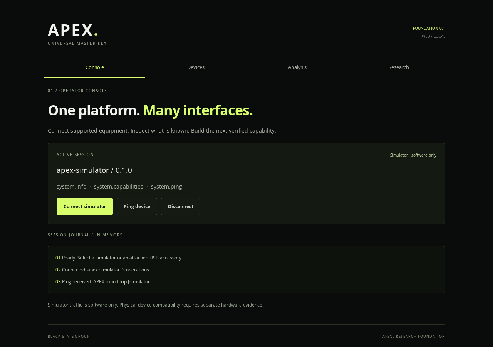

# APEX

**Universal Master Key**: a modular electronic interoperability platform from Black State Group.

**Mobile targets: iPhone and Android.** Native iOS integration remains pending; see [platform scope](docs/PLATFORM_SCOPE.md).

The [source-copy catalogue](research/SOURCE_COPIES.md) records 30 actual pinned upstream checkouts under `research/upstream-sources/`, with original licences, verified commits and independently retained source backups. Missing nested dependencies and unrecovered suggestions are listed explicitly.

One workspace for supported electronic systems across NFC/RFID, radio, Bluetooth, Wi-Fi, infrared, embedded accessories, vehicle electronics and industrial/access-control benches. Compatibility is recorded per operation, equipment revision and test environment. Protocol recognition and authenticated access are distinct.

## Design and research

- [Product requirements](docs/PRD.md)
- [Architecture](docs/ARCHITECTURE.md)
- [Capability matrix](docs/CAPABILITY_MATRIX.md)
- [Hardware strategy](docs/HARDWARE_STRATEGY.md)
- [Research register: 28 pinned projects](docs/RESEARCH_REGISTER.md)
- [Licensing inventory](docs/LICENSING.md)
- [Engineering work packages](docs/ENGINEERING_WORK_PACKAGES.md)
- [AXP/1 device protocol](docs/DEVICE_PROTOCOL.md)
- [Security research boundaries](docs/SECURITY_RESEARCH.md)
- [Verification record](docs/VERIFICATION.md)

The research branch defines the system. The dependent `feat/platform-foundation` branch establishes the Expo application, native Android module, shared protocol and portable C firmware. Review research before implementation. Physical hardware claims require separate evidence; no product-wide universal unlocking claim is made.

Research and security testing use owned or explicitly authorised equipment and controlled environments. Nothing is automatically merged, deployed or flashed.

## Run the foundation

Requires Node 24, npm, Python 3 and GCC for the portable C tests.

```sh
npm ci
npm test
npm run typecheck
npm run demo
npm run build
npm run web
```

`demo` connects the TypeScript session to the compiled C firmware process. The application offers a separate, explicitly selected simulator plus offline NEC and classic CAN analysis. Neither is a physical hardware test.

For browser checks after `npm run build`: `npx playwright install chromium` then `npm run test:ui`. `npm run inventory:check` verifies the lockfile licence inventory.

For native Android, install the Android SDK/JDK toolchain, run `npx expo prebuild --platform android --no-install` and `npm run android`. USB/NFC require a development build; Expo Go and web cannot load the custom Android module. The native source supports a conservative single CDC-ACM interface pair, not arbitrary USB serial chips. See the [firmware guide](firmware/README.md) for the ESP-IDF v6.1 target.

Current evidence and unexecuted native/hardware gates are recorded in [VERIFICATION.md](docs/VERIFICATION.md). Planned adapters are listed openly in the capability matrix. A bounded, data-only AI provider contract and hypothesis validator are implemented; no model or endpoint is connected. Captures and the session journal are in memory only. The durable vault, RF drivers and vehicle/industrial integrations remain work packages.



