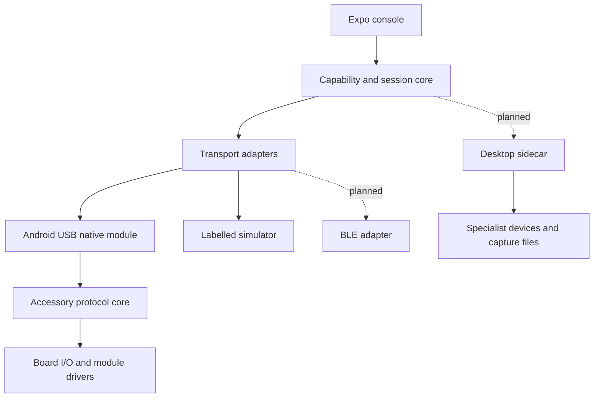

# Architecture

## System boundaries

APEX is a phone-first console with pluggable accessory and sidecar adapters. It does not attempt to port Flipper's MCU firmware into a phone process. The phone owns interaction, sessions, capability selection and local analysis. An accessory owns physical timing and its peripherals. A desktop sidecar owns high-rate acquisition and heavyweight vendor clients.

The diagram marks planned components. Native Android and ESP32 source are separate from verified host execution. See VERIFICATION.md for actual build and hardware evidence.

## Repository structure

| Path | Responsibility |
| --- | --- |
| App.tsx, src/ | Expo interaction and presentation; never register-level hardware access |
| packages/protocol/ | Original AXP/1 framing, CRC and streaming decoder |
| packages/core/ | Transport/session contracts, capability validation and offline analysers |
| modules/apex-device/ | Local Expo Kotlin module, USB CDC I/O, NFC reader and JS adapter |
| firmware/core/ | Portable C frame decoder and bounded command dispatcher |
| firmware/host/ | Real host executable using stdin/stdout for reproducible interoperability tests |
| firmware/esp32s3/ | ESP-IDF target using USB Serial/JTAG and the same C core |
| tests/, tools/ | Protocol, negative-input, integration and reproducibility checks |
| research/, docs/ | Immutable upstream references, requirements, decisions and evidence |

## Capability model

A capability names an operation, not a marketing category. Identity includes an adapter ID, protocol version, module/board/firmware revision and source kind. APEX distinguishes planned, source-only, host-verified and hardware-verified. A device's own claim is untrusted input, never a promotion to hardware-verified.

Initial accessory commands are identity, capabilities and ping. They expose a real communication surface without pretending to operate RF hardware. Offline NEC and classic CAN analysers are independent of accessory connectivity. A future driver must register only operations backed by detected hardware, and resource reservations must prevent conflicting GPIO, DMA, timer and RF use.

## Unified communication

AXP/1 defines a small binary envelope across byte transports. Request IDs correlate responses; errors are explicit frames. Both TypeScript and C validate version, type, flags, size and CRC before dispatch. Payloads are bounded. Control commands are not arbitrary strings or shell instructions. Unknown opcodes return a bounded error.

The session subscribes before sending, permits a bounded number of outstanding requests, checks response opcode and ID, applies a finite timeout and rejects all pending requests on disconnect. It never silently retries state changes. A future connection uses a fresh session; old events are discarded by removing listeners and resetting parser state. CRC detects accidental corruption, not a malicious peer. AXP/1 is deliberately restricted to a local development connection and does not yet provide authentication or encryption.

USB CDC is the first physical byte transport. Android owns per-device permission and interface claims. The native module selects a CDC-ACM communication interface and its associated data interface, configures line state, transfers complete bounded buffers and signals detach/read/write failures. It does not claim compatibility with every USB-to-UART bridge. Additional serial chips can later use usb-serial-for-android after testing and attribution.

BLE later fragments AXP frames according to negotiated MTU, uses bounded queues and write acknowledgement, and tests notifications arriving before promises resolve. BLE pairing alone does not authorise a downstream operation. Existing devices such as Meshtastic and Chameleon retain their native protocols behind adapters; they are not assumed to speak AXP.

## Native mobile boundary

The local Expo module uses public Android APIs. USB host, NFC and relevant runtime permission checks remain native. NFC reads foreground tag identity, technology list and cached NDEF record summaries; it does not impersonate arbitrary cards or extract secure data. UI and JavaScript do not receive USB file descriptors or unmanaged native pointers.

Web/Expo Go explicitly reports the native module as unavailable. Simulation is a user-selected mode, never a physical-hardware fallback. Android prebuild/autolinking is required after native changes, and a native APK build plus physical tests is a separate gate from JavaScript export.

## Firmware and hardware abstraction

The C core has fixed-size buffers, no heap and no platform includes. A board entry point supplies byte input/output and target identity. ESP32-S3 uses its USB Serial/JTAG CDC function; log output goes to UART so logs do not intentionally contaminate protocol traffic. Boot ROM text and truncated frames are handled through resynchronisation, not by trusting line boundaries.

Initial firmware includes no radio, NFC, CAN or RS-485 driver. Future modules have init/probe/read/stop functions and explicit ownership of buses, timing resources and power. Data acquisition runs independently of phone/UI scheduling. S3 is a practical first accessory, not the final all-in-one hardware commitment. nRF52840 and STM32 remain candidates for different timing, power and NFC requirements.

## Sidecar and data plane

Proposed sidecar: local authenticated service with a versioned RPC contract and an allowlisted operation registry. Native specialist libraries and clients run with restricted inputs, no shell interpolation and pinned versions. It returns parsed metadata and recording references. It does not expose arbitrary upstream CLI execution through the mobile app.

At 20 Msamples/s and 8-bit I plus 8-bit Q, a HackRF stream is approximately 40 MB/s before overhead. BLE and JSON bridge transfers are inappropriate. Record on the host, bound duration/storage, hash each recording and pass thumbnails/statistics/file references to the phone. A SigMF-compatible metadata exporter is planned; file format compatibility does not imply signal-content permission.

## Evidence and analysis

Future evidence object: schema/version, local observation ID, source kind, fixture/device identity, start/end UTC, monotonic durations, firmware/adapter/protocol versions, input hash, parser version, parameters, errors/dropped counts and licence/authority references. Claims link to observation IDs. M0 displays results in memory; durable encrypted capture storage and tamper-evident journals remain work packages.

Deterministic analysis runs first. AI later receives explicitly selected bounded inputs through a provider interface, returns structured hypotheses with uncertainty and provenance, and cannot call device transports directly. Reject fabricated source IDs and unsupported protocol labels. External data is untrusted content; instructions embedded in captures or metadata must not alter tool authority.

## Failure and recovery

Permission denied: show device but do not open. Unsupported interface: explicit error, no probing unrelated endpoints. Partial USB write: finish the bounded write or report failure; no silent success. Detach: close connection, stop worker, reject pending requests. Corrupt frame: discard/recover within bounded parser memory. Truncated plausible frame: finite session timeout; caller can reset/reconnect. Malformed response: reject and close negotiation. Process failure: preserve error, never replace with simulated success.

Before active modules: add accessory authentication, signed capability manifests/firmware, physical enable controls, target/region policy and recovery tests. These are product requirements with specific delivery packages; the current CRC is not presented as a security mechanism.

## Decisions

ADR-001: compose specialist devices instead of a monolithic firmware fork. ADR-002: Android native development build first. ADR-003: small original TypeScript/C control envelope and process-level conformance tests. ADR-004: separate control and high-rate capture data. ADR-005: upstream code remains external until selected-file licensing and hardware validation. ADR-006: evidence level is separate from implementation state and device claims.
