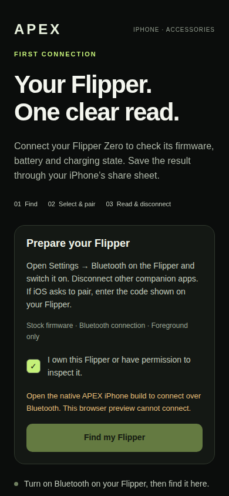

# iPhone Flipper milestone: implementation and verification

10 November 2026 · [Draft PR #24](https://github.com/BlackStateGroup/APEX/pull/24)

The software for the first iPhone accessory workflow is implemented. The physical
milestone is **not complete**: the user has no accessory yet, and no APEX build
has been signed or installed on their iPhone. The user confirmed that an Apple
Developer account is available. Its signing team/profile and device registration
have not been connected to this project.

## Delivered

- An opt-in iPhone screen for explicit discovery, device selection, OS pairing,
  reading six status fields, disconnecting and opening a share sheet for the result.
- A native Bluetooth adapter for stock Flipper GATT services, including unknown,
  black, white and transparent advertisement identifiers. No custom firmware,
  protobuf bindings, RPC command surface or device flashing.
- Correct field labels for Flipper's hardware target and firmware build;
  battery/charging data; device-reported provenance without identity attestation.
- Cancellation, timeout, backgrounding and unexpected-disconnection handling.
  Native operations remain owned through settlement; uncertain cleanup blocks reuse.
- Separate iPhone bundle identifier, internal Release/simulator build profiles,
  primary-source notes and an exact physical acceptance checklist.

Default APEX remains unchanged apart from broader Bluetooth permission wording.
This branch is based on main and does not incorporate or modify PR #22's USB lab.

## Verified software evidence

Application code commit: `ed76284e80bfb3485600b2dd635063ec32ae3bc3`.
The subsequent `d5bf10093080abef9f9fba181fd97395abb2efcc` changes **only** the new
browser test's text selector. Application source and build configuration are identical.

| Check | Result | Evidence |
| --- | --- | --- |
| Full host suite | **2,556 passed** | [Foundation host job](https://github.com/BlackStateGroup/APEX/actions/runs/42844758750/job/129929360016) |
| Existing browser regression suite | **40 passed** | Same foundation host job |
| New status/controller/native-adapter tests | **17 passed** | [Status software job](https://github.com/BlackStateGroup/APEX/actions/runs/42844758752/job/129929375097), before the later browser assertion |
| TypeScript, dependency inventory, firmware sanitizers, all-platform export | Passed | Foundation host job |
| Default iPhone Simulator app | Unsigned compilation passed | [Foundation iOS job](https://github.com/BlackStateGroup/APEX/actions/runs/42844758750/job/129929360392) |
| Opt-in iPhone Simulator Release app and embedded JavaScript | Unsigned compilation passed | [Flipper Release job](https://github.com/BlackStateGroup/APEX/actions/runs/42844758752/job/129929374301) |
| Android existing application | APK assembly and native checks passed | [Android job](https://github.com/BlackStateGroup/APEX/actions/runs/42844758750/job/129929359835) |
| Existing ESP32 target | Cross-compilation passed | [ESP32 job](https://github.com/BlackStateGroup/APEX/actions/runs/42844758750/job/129929359387) |
| New screen browser test | **Passed** at 390×844; ownership checkbox operates, browser connection stays disabled, no page errors or horizontal overflow | [Corrected screen job](https://github.com/BlackStateGroup/APEX/actions/runs/42852723307/job/129957629204) on `d5bf100` |

Local verification also passed the host suite before the final readiness test was
added (2,555 tests), all 17 final focused tests, TypeScript, dependency inventory,
default exports and the opt-in web export. Local Chromium failed to launch because
the environment denied its Unix socket. The separate cloud browser could not
reach the local preview server. Neither is presented as successful rendering.

The first new-screen check used a text selector that also matched the instructions.
The selector-only correction passed in GitHub CI. The corrected job also reran
all 17 focused tests and TypeScript successfully. Automatic native/foundation
reruns on that selector-only revision are separate from the successful application
code checks listed above; application source and build configuration did not change.

The browser screenshot was retrieved from workflow artifact `13780244285` and
visually inspected. ZIP SHA-256:
`f986a0f956f9eef7de2f792e9836c7b74b42d0bf5f8d9e9e2465d3b55e7c1904`.
PNG SHA-256:
`34878663af9e7ca0de72c8864ae69a0f34a562d0d94cc904708c128098388048`.
This is a real browser preview, not an iPhone or accessory acceptance screenshot.

## Required for the real demonstration

1. Stock Flipper Zero and the user's iPhone. No special cable or custom accessory
   firmware is required by this implementation.
2. Authorised Apple signing configuration and device registration, followed by
   the `flipper-iphone` build. No signing credentials are available in this session.
3. Install and complete the [physical checklist](IPHONE_FLIPPER_FIRST_CONNECTION.md#physical-acceptance-receipt-all-pending):
   permission denial/retry, pairing, status agreement, cancellation, backgrounding,
   device power-off, repeat connections and saving/reopening the shared report.
4. Record the exact phone, OS, accessory firmware and app revision. Software
   tests and simulator compilation cannot supply those observations.

Nothing merged, published to an app store, installed on a phone, provisioned or
flashed. No physical accessory or phone test occurred. Hardware purchase is not
performed. Existing merge/flashing approval boundaries remain in place.
